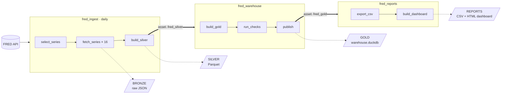

# FRED Medallion Pipeline: Apache Airflow 3 + DuckDB

A hands-on teaching case on building and orchestrating a data pipeline.
Economic time series are fetched from the Federal Reserve Bank of
St. Louis (FRED) API, refined through the **Medallion Architecture**
(bronze → silver → gold), and modeled as **star schemas** in **DuckDB**,
an analytic SQL engine that runs inside Python. Everything runs on a
laptop with Docker; no database server is needed for the analytic data.

**Students** start with [Running Airflow](#running-airflow), the
[student guide](docs/student_guide.md), and then the
[lab handout](docs/lab_handout.md). **Instructors** should also read
[For instructors](#for-instructors).

## What you will learn

- **Orchestration with Apache Airflow 3:** DAGs, the TaskFlow API,
  dynamic task mapping, retries and backoff, data-aware scheduling with
  assets, and reading the Airflow UI.
- **The Medallion Architecture:** landing raw data unchanged, cleaning
  and conforming it, and modeling it for analysis.
- **Dimensional modeling:** star schemas at different grains, calendar
  keys such as YYYYQ, conformed dimensions, and rolling up rates, levels,
  and flows correctly.
- **Data reliability:** idempotent loads, deduplication, data quality
  checks, and write-audit-publish.
- **Analytic SQL with DuckDB:** querying JSON and Parquet files in place,
  window functions, `QUALIFY`, and `PIVOT`.

## How the pipeline fits together

Four DAGs, linked by **assets**: each DAG runs when the data it depends
on changes.



| Layer | Stored as | Built by | Purpose |
| --- | --- | --- | --- |
| Bronze | raw JSON files, partitioned by series and ingest date | `fetch_series` (16 parallel tasks) | an exact, replayable copy of what the API returned |
| Silver | Parquet files | `build_silver` (DuckDB in memory) | typed, cleaned, deduplicated, with calendar keys |
| Gold | `data/gold/warehouse.duckdb` | `fred_warehouse` | star schemas, checked before they are published |
| Reports | CSV and a self-contained HTML dashboard | `fred_reports` | files for people who do not write SQL |

The data covers 16 FRED series at five frequencies, from the daily fed
funds rate and S&P 500 to weekly money supply, monthly unemployment and
CPI, quarterly GDP, and yearly inflation (see
[`dags/config/fred_series.json`](dags/config/fred_series.json)).

## Running Airflow

Airflow runs on your laptop as a set of Docker containers. You do not
install Airflow or Python yourself; Docker builds an image with
everything the pipeline needs. Plan on about 30 minutes the first time,
most of it waiting for downloads, so do it **before class** and not on
the classroom network.

**In a hurry?** If you already have Docker running and a FRED key:

```bash
git clone <this repository's URL> fred-airflow
cd fred-airflow
cp .env.example .env            # then put your key in .env
docker compose up -d --build
```

Open <http://localhost:8080> (`admin` / `admin`), unpause
**fred_warehouse** and **fred_reports**, then **fred_ingest**. The
steps below explain each part.

### 1. Install the prerequisites

| Tool | Why | Get it |
| --- | --- | --- |
| Docker Desktop | runs Airflow and its database | [docker.com](https://www.docker.com/products/docker-desktop/) |
| Git (optional) | downloads the repository | [git-scm.com](https://git-scm.com/downloads), or use **Code → Download ZIP** on GitHub |
| DuckDB CLI 1.4 or later | queries the data yourself (lab Parts C to E) | [duckdb.org](https://duckdb.org/docs/installation/); a single file, no installer. If you cannot install it, use the [copy inside the container](#no-duckdb-on-your-laptop) |
| A web browser | the Airflow UI | any current browser |

Notes for Docker Desktop:

- **Windows:** Docker Desktop uses WSL 2. If the installer asks you to
  enable WSL 2 or to restart, do so. Windows 10/11 Home works.
- **Memory:** give Docker at least **4 GB**. On Windows with WSL 2,
  Docker uses up to half of your RAM by default, which is fine with
  8 GB or more. On macOS, check **Settings → Resources → Memory**.
- **Start it:** Docker Desktop must be running (the whale icon in the
  taskbar or menu bar) whenever you use Airflow. Check from a terminal:
  ```bash
  docker version
  ```
  If this prints a **Server** section, Docker is ready.

### 2. Get a FRED API key

Create a free account at FRED and request a key at
<https://fred.stlouisfed.org/docs/api/api_key.html>. The key is a
32-character string of letters and numbers. It usually arrives at once,
but request it a day early to be safe. Use your **own** key: FRED limits
requests per key, so sharing one slows everyone down.

### 3. Get the code

Either clone with Git:

```bash
git clone <this repository's URL> fred-airflow
cd fred-airflow
```

or download the ZIP from GitHub (**Code → Download ZIP**), unzip it, and
open a terminal in the unzipped folder. On Windows, avoid folders synced
by OneDrive; a plain folder such as `C:\Users\you\Projects` works best.

All commands below run from this folder (the one that holds
`docker-compose.yaml`).

### 4. Add your key to `.env`

Copy the example file:

```bash
# macOS / Linux / Git Bash
cp .env.example .env
```

```powershell
# Windows PowerShell
Copy-Item .env.example .env
```

Open `.env` in a text editor and paste your key after the equals sign,
with no spaces or quotes:

```text
FRED_API_KEY=abcdef0123456789abcdef0123456789
```

On **Linux** only, also set `AIRFLOW_UID` to the output of `id -u`
(often `1000`) so that files the containers write belong to you.

`.env` holds your private key. It is listed in `.gitignore`; never
commit, upload, or share it.

### 5. Start Airflow

```bash
docker compose up -d --build
```

The first time, Docker downloads the Airflow and Postgres images (about
1 GB to download, about 4 GB on disk) and builds the project image,
which takes 3 to 10 minutes. Later starts take under a minute.

Check that everything came up:

```bash
docker compose ps -a
```

You should see:

| Service | Expected status | Role |
| --- | --- | --- |
| `postgres` | `Up (healthy)` | Airflow's own metadata database |
| `airflow-init` | `Exited (0)` | one-time setup; exiting is correct |
| `airflow-apiserver` | `Up (healthy)` | the web UI and REST API |
| `airflow-scheduler` | `Up (healthy)` | decides what runs and runs it |
| `airflow-dag-processor` | `Up (healthy)` | reads the DAG files in `dags/` |

A service may show `(health: starting)` for a minute or two; run the
command again. If something else appears, see
[Troubleshooting](#troubleshooting).

### 6. Open the Airflow UI

Go to <http://localhost:8080> and log in with user `admin`, password
`admin`. These are local teaching credentials; the UI is only reachable
from your own machine.

The **Dags** page lists four DAGs, all paused: `fred_ingest`,
`fred_warehouse`, `fred_reports`, and `dummy_etl_demo` (a small warm-up
example). If a DAG is missing, wait a minute; the DAG processor scans
`dags/` periodically.

### 7. Run the pipeline the first time

1. **Unpause the consumers first:** switch on **fred_warehouse** and
   **fred_reports**. They wait for data and do nothing yet. (A consumer
   that is paused when its data arrives does not catch up later; see
   [Behaviors worth knowing](#for-instructors).)
2. **Unpause fred_ingest.** Its first scheduled run starts within a
   minute and fetches all 16 series, which takes about one to two
   minutes.
3. **Watch it.** Open **fred_ingest** and its **Grid** view: tasks turn
   green as they succeed. When `build_silver` finishes, **fred_warehouse**
   starts on its own, and when it publishes, **fred_reports** follows.
   The **Assets** page shows these hand-offs across all DAGs.
4. **To run it again later,** click **Trigger** on **fred_ingest**.
   Leave `force_all` off for a normal run (only series that are due are
   fetched, often none), or switch it on to refetch every series. See
   [Triggering with `force_all`](#triggering-with-force_all).

#### Triggering with `force_all`

`force_all` is a **DAG parameter**, declared on the DAG in
`dags/fred_ingest_dag.py`:

```python
params={
    "force_all": Param(False, type="boolean",
                       description="Fetch every series, ignoring the frequency intervals."),
},
```

You set it **before** a run starts; once a run has started, its
parameters are fixed. To set it:

1. Open **fred_ingest** and click **Trigger** (top right).
2. The dialog lists the DAG's parameters. Because `force_all` is declared
   as a boolean, it appears as an on/off switch with its description.
3. Switch it on and click **Trigger**.

Or from the command line:

```bash
docker compose exec airflow-scheduler airflow dags trigger fred_ingest -c '{"force_all": true}'
```

The first task, `select_series`, reads the value at run time and decides
which series to fetch. Worth knowing:

- **Scheduled runs always use the default** (`False`). Only a manual
  trigger (UI, CLI, or REST API) can change it.
- **The value is stored with the run.** Select a run in the Grid view and
  open its **Details** to see the parameters it ran with.
- **Clearing a task reuses the run's original parameters.** Clearing
  `select_series` on a run that had `force_all` off reruns it with
  `force_all` off. To refetch everything, trigger a new run instead.

If you are following the [lab handout](docs/lab_handout.md), follow its
steps instead: it has you leave **fred_reports** paused until Part F.

### 8. Look at the results

Everything the pipeline produces lands in `data/` on your own disk,
because that folder is shared with the containers:

- `data/bronze/fred/…`: raw JSON responses from FRED
- `data/silver/fred/*.parquet`: cleaned, typed tables
- `data/gold/warehouse.duckdb`: the star-schema warehouse
- `data/reports/macro_dashboard.html`: a dashboard; open it in a browser

Query the warehouse with the DuckDB CLI. Always open it read-only, so
Airflow can keep publishing new builds:

```bash
duckdb -readonly data/gold/warehouse.duckdb
```

or run the guided tour in [`analysis/demo_queries.sql`](analysis/demo_queries.sql)
from the project folder:

```bash
duckdb -c ".read analysis/demo_queries.sql"
```

#### No DuckDB on your laptop?

The Airflow image includes the same DuckDB CLI as a backup. Put
`docker compose exec airflow-scheduler` in front of any `duckdb` command;
it starts in `/opt/airflow`, where `data/` and `analysis/` are mounted,
so the same relative paths work:

```bash
docker compose exec airflow-scheduler duckdb -readonly data/gold/warehouse.duckdb
```

```bash
docker compose exec airflow-scheduler duckdb -c ".read analysis/demo_queries.sql"
```

Type `.quit` to leave. Airflow must be running for this to work. In Git
Bash on Windows, use PowerShell instead, or prefix the command with
`MSYS_NO_PATHCONV=1` if you pass a path that starts with `/`.

### 9. Stop, restart, and reset

| To… | Run | What is kept |
| --- | --- | --- |
| stop Airflow | `docker compose down` | everything: data, run history, settings |
| start it again | `docker compose up -d` | — |
| see a service's log | `docker compose logs -f airflow-scheduler` | — |
| apply a change to `.env` | `docker compose up -d` | everything |
| wipe Airflow's run history | `docker compose down -v` | your `data/` folder |

Edits to files under `dags/` (Python, SQL, and JSON config) are picked
up automatically within a minute or so; you do not need to restart.
Stopping Docker Desktop or shutting down your laptop is also safe; run
`docker compose up -d` when you come back.

## Course materials

| Material | For | What it is |
| --- | --- | --- |
| [Lab handout](docs/lab_handout.md) | students | a guided, roughly 100-minute lab in six parts with questions Q1 to Q20 |
| [Student guide](docs/student_guide.md) | students | companion to the teaching case: key terms, where the case meets the code, a reading order, and discussion prep |
| [`analysis/demo_queries.sql`](analysis/demo_queries.sql) | everyone | a DuckDB tour from bronze to gold in one session (`.read analysis/demo_queries.sql`) |
| [`analysis/example_queries.sql`](analysis/example_queries.sql) | everyone | star joins, drill-across, growth rates, and rollup comparisons |

## Repository layout

```
dags/
  fred_ingest_dag.py        DAG 1: bronze (raw JSON) and silver (Parquet)
  fred_warehouse_dag.py     DAG 2: gold star schemas (write, audit, publish)
  fred_reports_dag.py       DAG 3: CSV and HTML dashboard from gold
  dummy_dag.py              a minimal intro DAG (operators, XCom)
  common/                   shared helpers and asset definitions
  config/fred_config.json   API settings, fetch intervals, fault injection
  config/fred_series.json   which series to fetch and how to roll them up
  sql/silver/               bronze JSON to silver Parquet
  sql/gold/                 silver Parquet to star schemas
  sql/checks/               data quality rules (each returns violating rows)
  sql/reports/              report exports
analysis/                   DuckDB query scripts
docs/                       lab handout and student guide
data/                       bronze, silver, gold, reports (created at run time)
docker-compose.yaml         Airflow 3.3 with LocalExecutor and Postgres
```

## The layers in detail

### Bronze: land it exactly as received

```
data/bronze/fred/series_id=GDP/ingest_date=2026-10-05/
    series.json         series metadata (title, units, frequency, ...)
    observations.json   the full time series, as returned by the API
    _ingest.json        lineage: run id, attempt number, row count, bytes
```

- The JSON is saved untouched, so silver can always be rebuilt if the
  cleaning logic changes, without calling the API again.
- `key=value` folder names (Hive partitioning) become columns in DuckDB.
- Files are written to a temporary name and then renamed, so readers
  never see half a file. Re-running a day overwrites that day's folder,
  so the step is **idempotent**.

### Silver: clean, typed, conformed

DuckDB reads every bronze file in one query and writes
`data/silver/fred/series.parquet` and `observations.parquet`
([`dags/sql/silver/`](dags/sql/silver/)):

- **Schema on read:** the expected JSON structure is declared in SQL.
- **Deduplicate:** each fetch lands the full history again, so only the
  newest ingest per series and date is kept (`QUALIFY row_number()`).
  FRED revises past values, so the newest value wins.
- **Clean:** FRED's `'.'` (no value) becomes `NULL`, flagged `is_missing`.
- **Make periods explicit:** FRED dates monthly and quarterly values by
  the first day of the period but weekly values by the last day, so
  silver adds `period_start_date` and `period_end_date`.
- **Calendar keys**, integers taken from the period end:

  | Key | Example | Meaning |
  | --- | --- | --- |
  | `obs_date_key` | `20260701` | YYYYMMDD |
  | `week_key` | `202627` | ISO year + ISO week |
  | `month_key` | `202607` | YYYYMM |
  | `quarter_key` | `20263` | YYYYQ |
  | `year_key` | `2026` | YYYY |

### Gold: star schemas

Built from silver into `data/gold/warehouse.duckdb`
([`dags/sql/gold/`](dags/sql/gold/)). DuckDB enforces the primary and
foreign keys during the build.

| Table | Grain | Joins to |
| --- | --- | --- |
| `dim_date` | day | generated in SQL; weekday, ISO week, period flags |
| `dim_month`, `dim_quarter`, `dim_year` | month, quarter, year | rollup ("shrunken") dimensions derived from `dim_date` |
| `dim_series` | one FRED series | units, frequency, `aggregation_method` |
| `fact_daily_observation` | series × day | `dim_date`, `dim_series` |
| `fact_weekly_observation` | series × week | `dim_date` (week-ending date), `dim_series` |
| `fact_monthly_observation` | series × month | `dim_month`, `dim_series` |
| `fact_quarterly_observation` | series × quarter | `dim_quarter`, `dim_series` |
| `fact_annual_observation` | series × year | `dim_year`, `dim_series` |
| `fact_macro_quarterly` | series × quarter, all frequencies | `dim_quarter`, `dim_series` |
| `macro_quarterly_wide` | one row per complete quarter | a pivot for reporting |

`fact_macro_quarterly` rolls every daily, weekly, monthly, and quarterly
series up to `quarter_key`, so series of different frequencies can be
compared side by side. How a series rolls up depends on what it measures:

| `aggregation_method` | Use for | Examples |
| --- | --- | --- |
| `avg` | rates and indexes | unemployment rate, fed funds rate, CPI, VIX |
| `eop` (end of period) | levels | M2, federal debt, S&P 500 |
| `sum` | flows that accumulate | monthly retail sales |

`is_complete` is false for the quarter still in progress, so a partial
quarter is never mistaken for a full one.

## Airflow concepts demonstrated

| Concept | Where to look |
| --- | --- |
| TaskFlow API (`@dag`, `@task`) and Airflow 3 `airflow.sdk` imports | all DAGs |
| Dynamic task mapping (`.expand`) | `fetch_series`, one task per series |
| Concurrency limits (`max_active_tis_per_dag`, `max_active_runs`) | `fetch_series`, all DAGs |
| Retries, exponential backoff, `execution_timeout` | `fetch_series` |
| Failing fast on permanent errors (`AirflowFailException`) | HTTP 4xx handling in `call_fred` |
| Fault injection, to watch retries happen | `fault_injection` in `fred_config.json` |
| Run-time decisions instead of parse-time code | `select_series` |
| DAG params (`force_all`) | the Trigger dialog in the UI; see [Triggering with `force_all`](#triggering-with-force_all) |
| Secrets as Variables (`AIRFLOW_VAR_*` environment variables) | FRED key, optional Slack webhook |
| Data-aware scheduling with assets | `fred_silver` triggers `fred_warehouse` |
| Asset chains: a new consumer without changing the producer | `fred_gold` triggers `fred_reports` |
| Write-audit-publish with data quality checks | `fred_warehouse` |
| Failure callbacks | `common/medallion.py` |

## Things to try

- **Watch retries:** set `"enabled": true` under `fault_injection` in
  `dags/config/fred_config.json`, trigger `fred_ingest` with
  `{"force_all": true}`, and open a `fetch_series` task's tries.
- **Fail a data quality check:** change GDP's `frequency` to `monthly` in
  `fred_series.json` and trigger with `{"force_all": true}`; `run_checks`
  stops the publish. Changing UNRATE to `quarterly` instead fails earlier,
  in `build_gold`, on a primary key. Either way the live warehouse is
  untouched.
- **Fail fast:** add a series id that does not exist; it fails without
  retrying.

Undo each change afterwards.

## Exercises

1. **Incremental gold.** Gold is fully rebuilt each run. Rewrite one fact
   table load as an incremental `MERGE INTO` and discuss the trade-offs.
2. **Stable surrogate keys.** `series_key` follows `series_id` order, so
   adding a series can renumber it. Design keys that never change.
3. **Slowly changing dimension.** FRED sometimes changes a series' title
   or units. Make `dim_series` a Type 2 SCD using the bronze history.
4. **Trading calendar.** Add `is_trading_day` to `dim_date` using the days
   the S&P 500 has values, and compare averages over trading days with
   averages over all days.
5. **Annual rollup.** Build `fact_macro_annual` and decide how
   `is_complete` should work at year grain.
6. **Quarter completeness.** Add a check that flags `sum` series with
   fewer than three months in a complete quarter.
7. **A second source.** Fetch stock prices (for example with `yfinance`)
   into `bronze/yahoo/` and build `fact_stock_daily` on the shared
   `dim_date` and `dim_quarter`. Unofficial APIs fail often: use retries,
   a pool, and trigger rules so a failed source never blocks the FRED
   warehouse.

## For instructors

**Session plan.** About 40 minutes of lecture and demonstration, then
the lab (about 100 minutes, or split across two meetings). A teaching
note with session plans and suggested answers, and a slide deck with
speaker notes, are available from the authors.

**Before class**

- [ ] Each student has a FRED API key. Keys are free but take a few
      minutes to request; have students get one in advance.
- [ ] Students have Docker Desktop installed with 4 GB or more of memory,
      and have run `docker compose up -d --build` once, so the image
      download happens before class rather than on the classroom network.
- [ ] Students have the DuckDB CLI, version 1.4 or later. Anyone who
      cannot install it can use the copy in the Airflow image
      ([No DuckDB on your laptop?](#no-duckdb-on-your-laptop)).
- [ ] On your demo machine, refresh the data: trigger `fred_ingest` with
      `{"force_all": true}`.
- [ ] Pause `fred_reports` if you will run lab Part F, which starts with
      it paused.

**Answer key.** An instructor answer key for the lab (Q1 to Q20 and the
reflection questions) is kept out of this repository so students cannot
see it. Contact the authors for a copy.

**Behaviors worth knowing**

- Asset-scheduled DAGs that are paused when their asset updates do not
  run when unpaused; they run on the next update, and that run lists the
  events they missed. This is why the consumers are unpaused first. Lab
  question Q19 explores it.
- Each frequency is fetched only every *N* days (`intervals` in
  `fred_config.json`), so a scheduled run often fetches nothing. That is
  by design, and is the point of lab question Q7.
- FRED data changes as new values are released and old ones revised, so
  student answers with counts and values will differ slightly from the
  answer key. Grade the reasoning.
- FRED's rate limit applies per API key, so students who share a key can
  slow each other down. Each student should use their own key.

**Resetting.** `docker compose down -v` deletes Airflow's run history.
Delete the `fred` folders under `data/bronze` and `data/silver`, and the
files under `data/gold` and `data/reports`, for a completely fresh start.

## Troubleshooting

| Symptom | Likely cause | Fix |
| --- | --- | --- |
| "Cannot connect to the Docker daemon" or "pipe/dockerDesktopLinuxEngine" not found | Docker Desktop is not running | start Docker Desktop and wait until it says it is running |
| `docker compose up` stops with a `FRED_API_KEY` error | no `.env`, or the key is blank | create `.env` from `.env.example` and add your key |
| "no configuration file provided" | the terminal is in the wrong folder | `cd` into the folder that holds `docker-compose.yaml` |
| <http://localhost:8080> does not load | the API server is still starting | wait until `docker compose ps` shows it `healthy`; otherwise `docker compose logs airflow-apiserver` |
| `airflow-init` shows `Exited (1)` | setup failed | `docker compose logs airflow-init`, fix the cause, then `docker compose up -d` |
| Permission errors on `logs/` or `data/` (Linux) | `AIRFLOW_UID` does not match your user | set `AIRFLOW_UID` in `.env` to `id -u`, then `docker compose up -d` |
| `fetch_series` fails at once with HTTP 400 or 403 | wrong API key | fix `.env`, then run `docker compose up -d` |
| Port 8080 is already in use | another program uses it | change `"8080:8080"` to `"8081:8080"` in `docker-compose.yaml` |
| Containers keep restarting | Docker has less than 4 GB of memory | raise the limit in Docker Desktop settings |
| A DAG is missing from the UI | a Python error in a DAG file | `docker compose exec airflow-scheduler airflow dags list-import-errors` |
| A run fetches nothing | no frequency is due today | trigger with `{"force_all": true}` |
| "Could not set lock on file … warehouse.duckdb" | a client has the warehouse open for writing | close it; always open the warehouse read-only |
| `duckdb` is not recognized | the CLI is not on your PATH | install it, or open a new terminal after installing, or use the [copy inside the container](#no-duckdb-on-your-laptop) |
| Logs take a lot of disk space | task logs accumulate in `logs/` | delete old folders there |

## Data source

Data from FRED, Federal Reserve Bank of St. Louis,
<https://fred.stlouisfed.org/>. Use of the FRED API is subject to its
[terms of use](https://fred.stlouisfed.org/docs/api/terms_of_use.html);
some series, such as the S&P 500, carry additional restrictions from
their original publishers.

## License

The code and documentation in this repository are released under the
[MIT License](LICENSE). The license covers this repository only, not the
FRED data the pipeline downloads, which remains subject to FRED's terms.
